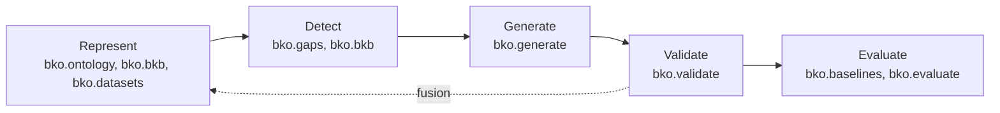

# Architecture

Sources: [2-pager](../papers/proposal-2-pager.pdf) sections 3, 4, 5 and 6; [research brief](../papers/research-brief.pdf) F16; facts verified outside the PDFs (pybkb, ofs_app, synthcity resolution).

> **Status: planned; no stage is built.** Every `src/bko/` subpackage holds only its docstring and
> README.

How the planned system fits together. The method each stage implements is in
[RESEARCH.md](RESEARCH.md#3-approach); each stage's README is the home for its role, extra, owner
and status.

## Tools

The tools the 2-pager names (section 4):

| Concern | Tool | Notes |
|---|---|---|
| Front end | Streamlit over a Python backend | |
| Ontology access | owlready2, pronto, OLS4 | |
| Record generation | Anthropic Messages API | |
| Baselines | CTGAN (Conditional Tabular GAN), TVAE (Tabular Variational AutoEncoder), SMOTE (Synthetic Minority Over-sampling Technique), ADASYN (Adaptive Synthetic Sampling) | CTGAN and TVAE come from SDV, SMOTE and ADASYN from imbalanced-learn |
| Evaluation | scikit-learn, SDMetrics, synthcity | synthcity is not a dependency: it does not resolve on Python 3.14 (ADR [tooling/python-314-without-synthcity](adr/tooling/python-314-without-synthcity.md)). Evaluation uses scikit-learn and SDMetrics ([RESEARCH.md](RESEARCH.md#5-evaluation-contract)) |
| Code | A GitHub repository | |
| Data | UCI Heart Disease and Synthea, both openly available | [RESEARCH.md](RESEARCH.md#6-datasets) |

**Principal risk.** The 2-pager states: "The principal risk is that no public BKB library exists, so
the inference layer will be built by the team." That statement is superseded: pybkb is a public BKB
library ([Prior code](#pybkb)). The inference layer is planned as a port of its core rather than a
build from nothing, and porting any of it makes this repository GPL-3.0 if distributed.

## Pipeline

| Stage | Takes | Produces |
|---|---|---|
| Represent | MONDO, HPO and the dataset | A BKO: the ontology fragments fused with the dataset fragment, weighted by observed frequency |
| Detect | The BKO | BKO-detected gaps (ungrounded statements), with count-based gaps alongside for comparison |
| Generate | Each gap and its relevant ontology relationships | Candidate records, through the Anthropic Messages API |
| Validate | Candidate records | The records that pass the consistency checks and numeric range constraints |
| Evaluate | Augmented training data, the baselines and the controls | The success criteria ([RESEARCH.md](RESEARCH.md#4-success-criteria)) |

The dotted edge is the fusion of validated records back into the BKO, after which the completeness
criterion counts the gaps that close; [BACKGROUND.md](BACKGROUND.md#fusion) explains that reading
of "after fusion". The Streamlit front end (`bko.app`) sits over every stage.

## Package map

Which pipeline stage each subpackage serves. Each stage README is the one home for its role, extra,
owner and status, and ADR [`tooling/src-layout`](adr/tooling/src-layout.md) records the layout; what
each extra installs is in [DEVELOPMENT.md](DEVELOPMENT.md#environment).

| Subpackage | Stage |
|---|---|
| [`bko.datasets`](../src/bko/datasets/README.md) | Represent (the dataset fragment) and Evaluate (training data) |
| [`bko.ontology`](../src/bko/ontology/README.md) | Represent (ontology loading, concept-to-field mapping) |
| [`bko.bkb`](../src/bko/bkb/README.md) | Represent and Detect (BKB fusion and reasoning) |
| [`bko.gaps`](../src/bko/gaps/README.md) | Detect |
| [`bko.generate`](../src/bko/generate/README.md) | Generate |
| [`bko.validate`](../src/bko/validate/README.md) | Validate |
| [`bko.baselines`](../src/bko/baselines/README.md) | Evaluate (baseline augmentation) |
| [`bko.evaluate`](../src/bko/evaluate/README.md) | Evaluate |
| [`bko.app`](../src/bko/app/README.md) | Front end over every stage |

Fusion appears in two places: Shirley's workstream names it (2-pager section 6), and `bko.bkb`,
which Partiban owns, holds the fusion operation.

## Demo-Day flow

The brief (F16) proposed this flow. Its premise: Track A requires a product, so the demo must be
clickable, not a notebook, and is buildable with a Streamlit or Gradio front end, a Python back end
and an LLM API.

1. **Upload or pick a dataset** (default: UCI Heart Disease or a Synthea extract). The user sees the
   row count and class balance.
2. **"Analyze gaps".** The app maps columns to an ontology (HPO, MONDO or SNOMED through the
   OLS/BioPortal API) and renders a visual coverage map or tree, with under-represented concepts in
   red (the brief's "Bayesian coverage score"). The brief calls this the visual wow-moment and the
   ontology differentiator.
3. **"Fill gaps".** The user picks a method from a dropdown (CLLM, GReaT, CTGAN, TVAE or SMOTE) and
   the app generates synthetic rows targeting the red regions. Ontology or SHACL validation rejects
   implausible rows live, with a rejected-row counter on screen.
4. **"Human-in-the-loop"** (an optional tab). For the thinnest gaps, the app drafts questions for a
   human expert or an LLM to supply real values.
5. **"Evaluate".** A one-click dashboard: fidelity (KS/TVD, correlation heatmaps), a TSTR-versus-TRTR
   AUC/F1 bar chart, and privacy (DCR). The headline number is the rare-class recall/AUC improvement
   over the no-augmentation baseline.
6. **Download** the augmented dataset and a one-page "synthetic data quality report".

What the judge sees: an upload, an ontology coverage tree that lights up red and green, a choice of
generation method, gaps filling while implausible rows are rejected, and a dashboard showing the
downstream detection model getting measurably better.

The 2-pager's method choices govern where they differ from the flow:

| Point | Brief F16 | Plan |
|---|---|---|
| Front end | Streamlit or Gradio | Streamlit |
| Step 2 | HPO, MONDO or SNOMED through OLS/BioPortal; a Bayesian coverage score | MONDO and HPO through owlready2, pronto and OLS4; gaps are ungrounded BKO statements, with count-based gaps alongside |
| Step 3 | A dropdown of CLLM, GReaT, CTGAN, TVAE and SMOTE; SHACL validation | Generation through the Anthropic Messages API, compared against CTGAN, TVAE, SMOTE and ADASYN; validation against the consistency checks and range constraints |
| Step 4 | Optional human-in-the-loop tab | Not planned ([IDEAS.md](IDEAS.md#human-in-the-loop-expert-questions)) |
| Step 5 | Improvement over no augmentation | The success criteria, which add the class-weighting control and the baselines ([RESEARCH.md](RESEARCH.md#4-success-criteria)) |

## Prior code

### pybkb

[pybkb](https://github.com/di2ag/pybkb), by Chase Yakaboski, is a Python package for reasoning and
learning with Bayesian Knowledge Bases.

- **License**: GPL-3.0. Porting any of it makes this repository GPL-3.0 if distributed.
- **State**: last commit 2023-11-09; not on PyPI; the README is empty.
- **Pins**: Python ~3.11, torch 2.0.1, numpy 1.24.4, pandas 1.x, gurobipy 10.0.2, pygobnilp (a
  Bitbucket git dependency) and ray. It therefore cannot be a dependency on this repository's
  Python 3.14, but its core is portable.
- **`learn/`** needs gobnilp and gurobi.

The core, with line counts at the last commit:

| Path | Lines | Holds |
|---|---|---|
| `pybkb/bkb.py` | 682 | The BKB structure |
| `pybkb/fusion/__init__.py` | 198 | `fuse(bkfs, reliabilities, ...)` |
| `pybkb/reason/bkb.py` | 158 | `BKBReasoner.update` |
| `pybkb/utils/probability.py` | 779 | Probability routines, using numba |

The port is the task unit [tasks/proposal-bkb-port.md](../tasks/proposal-bkb-port.md). pybkb's
existence supersedes the 2-pager's statement that no public BKB library exists
([RESEARCH.md](RESEARCH.md#9-source-reconciliation)).

### ofs_app

[di2ag/ofs_app](https://github.com/di2ag/ofs_app) describes itself as "Ontology Fusion Service using
Bayesian Knowledge Base Fusion and Reasoning". It is a TRAPI service template with no fusion code
and no license, and it is not used.
