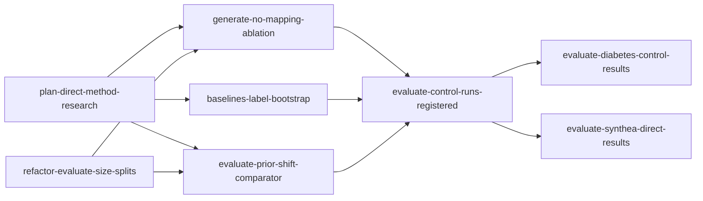

# Direct method: work-unit index

**What this set is.** The units that make `bko-direct` the primary method of the study, each one
pull request. The plan is [`docs/RESEARCH.md`](../docs/RESEARCH.md); a unit that changes a
criterion, a definition or a decision an ADR records edits that document in its own PR. Each
unit's `milestone` is `direct-method-research`, the
[ROADMAP milestone](../docs/ROADMAP.md#direct-method-research) this set serves.

## Graph and status

### Foundation

| Unit | Status | Depends on | Milestone |
|---|---|---|---|
| [`plan-direct-method-research`](plan-direct-method-research.md) | ready | -- | direct-method-research |
| [`refactor-evaluate-size-splits`](refactor-evaluate-size-splits.md) | ready | -- | direct-method-research |

### Controls

| Unit | Status | Depends on | Milestone |
|---|---|---|---|
| [`generate-no-mapping-ablation`](generate-no-mapping-ablation.md) | blocked | plan-direct-method-research, refactor-evaluate-size-splits | direct-method-research |
| [`baselines-label-bootstrap`](baselines-label-bootstrap.md) | blocked | plan-direct-method-research | direct-method-research |
| [`evaluate-prior-shift-comparator`](evaluate-prior-shift-comparator.md) | blocked | plan-direct-method-research, refactor-evaluate-size-splits | direct-method-research |
| [`evaluate-control-runs-registered`](evaluate-control-runs-registered.md) | blocked | generate-no-mapping-ablation, baselines-label-bootstrap, evaluate-prior-shift-comparator | direct-method-research |
| [`evaluate-diabetes-control-results`](evaluate-diabetes-control-results.md) | blocked | evaluate-control-runs-registered | direct-method-research |
| [`evaluate-synthea-direct-results`](evaluate-synthea-direct-results.md) | blocked | evaluate-control-runs-registered | direct-method-research |

## What every unit relies on

- Everything the experiments set relies on
  ([`experiments-index.md`](experiments-index.md#what-every-unit-relies-on)).
- **No unit edits an existing `RUNS` entry, an existing dataset's field rows or `bko-direct`'s
  draw.** Old run folders are re-read under identity checks, and the draw is pinned by digests,
  so a sampler change is a new arm name and a mapping change is a new dataset name.
- **A code unit lands its runs' names and Configuration; a results unit runs them.** A code unit
  adds the arm or reading, its named `RUNS` entries and the
  [`docs/EVIDENCE.md`](../docs/EVIDENCE.md) entry's Configuration with status `not yet run`. A
  results unit runs it and records Runs, Result and Read against.
- **Which data is development and which is confirmatory is the plan's to say**
  ([`docs/RESEARCH.md`](../docs/RESEARCH.md)).

## Where results go

[`docs/EVIDENCE.md`](../docs/EVIDENCE.md): a new entry per question.

## Spend

As the experiments set's ([`experiments-index.md`](experiments-index.md#spend)).

## Conventions

As the experiments set's ([`experiments-index.md`](experiments-index.md#conventions)).
