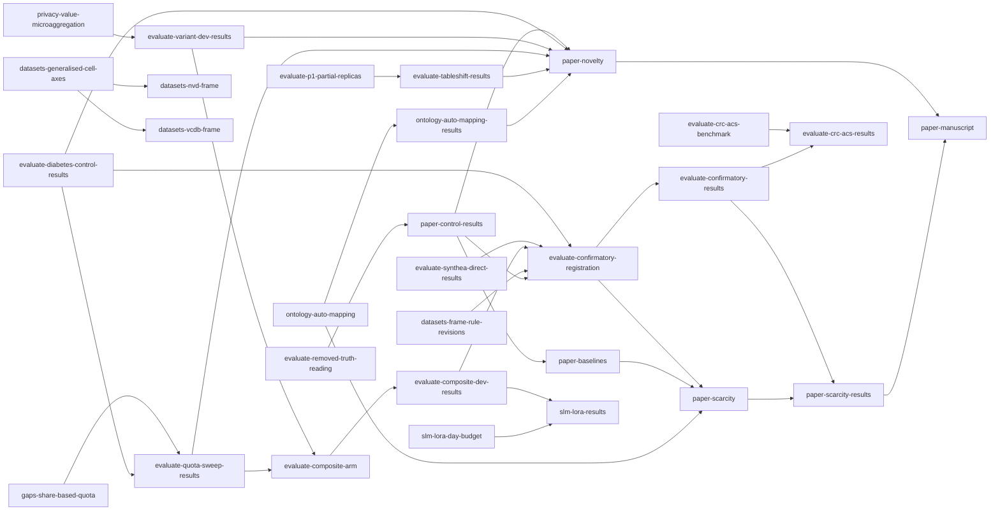

# Direct method: work-unit index

**What this set is.** The units that study `bko-direct` as the candidate of the direct-method study,
each one pull request. The plan is [`docs/RESEARCH.md`](../docs/RESEARCH.md); a unit that changes a
criterion, a definition or a decision an ADR records edits that document in its own PR. Each
unit's `milestone` is `direct-method-research`, the
[ROADMAP milestone](../docs/ROADMAP.md#direct-method-research) this set serves.

## Order of work

1. Code units, in landing order:
   [`evaluate-removed-truth-reading`](evaluate-removed-truth-reading.md) is the mechanism reading
   `paper-control-results` needs;
   [`privacy-value-microaggregation`](privacy-value-microaggregation.md) unblocks the variant runs;
   [`gaps-share-based-quota`](gaps-share-based-quota.md) unblocks the quota sweep;
   [`datasets-frame-rule-revisions`](datasets-frame-rule-revisions.md) gates the registration;
   [`evaluate-p1-partial-replicas`](evaluate-p1-partial-replicas.md) unblocks the TableShift runs;
   [`ontology-auto-mapping`](ontology-auto-mapping.md) unblocks its results unit.
2. Free runs that need no code:
   [`evaluate-diabetes-control-results`](evaluate-diabetes-control-results.md) and
   [`evaluate-synthea-direct-results`](evaluate-synthea-direct-results.md) both gate the
   registration. The E14 to E17 families are in `RUNS` already; their unit,
   [`evaluate-variant-dev-results`](evaluate-variant-dev-results.md), opens when E20 is
   registered.
3. After this batch: [`datasets-generalised-cell-axes`](datasets-generalised-cell-axes.md) lands
   alone; then [`evaluate-crc-acs-benchmark`](evaluate-crc-acs-benchmark.md),
   [`slm-lora-day-budget`](slm-lora-day-budget.md),
   [`evaluate-covariate-bias-results`](evaluate-covariate-bias-results.md) and
   [`evaluate-synthetic-share-results`](evaluate-synthetic-share-results.md).
4. After the results: [`paper-novelty`](paper-novelty.md), whose edges in the graph name the
   results units it waits for.

Landing-order constraints that are not dependencies:

- A unit that adds `RUNS` entries inserts them before `p1-id`, except
  `evaluate-p1-partial-replicas`, which inserts its two entries between `p1-ood` and `p2`.
- `gaps-share-based-quota` lands before `evaluate-p1-partial-replicas`: both add an `Experiment`
  field.
- `privacy-value-microaggregation` lands before `datasets-generalised-cell-axes`: both edit
  `src/bko/generate/direct.py`.
- `evaluate-removed-truth-reading` lands before `gaps-share-based-quota`: it moves the reader
  handlers out of `src/bko/evaluate/__main__.py` into `src/bko/evaluate/reader_commands.py`, which
  makes room in `__main__.py` for the quota unit's subcommand.
- `gaps-share-based-quota`'s `expected_size` reads the second cell axis by position, which
  `datasets-generalised-cell-axes` must keep.

## Graph and status

### Controls

| Unit | Status | Depends on | Milestone |
|---|---|---|---|
| [`evaluate-diabetes-control-results`](evaluate-diabetes-control-results.md) | ready | -- | direct-method-research |
| [`evaluate-synthea-direct-results`](evaluate-synthea-direct-results.md) | ready | -- | direct-method-research |

### Method and measurement

| Unit | Status | Depends on | Milestone |
|---|---|---|---|
| [`evaluate-removed-truth-reading`](evaluate-removed-truth-reading.md) | ready | -- | direct-method-research |
| [`privacy-value-microaggregation`](privacy-value-microaggregation.md) | ready | -- | direct-method-research |
| [`evaluate-variant-dev-results`](evaluate-variant-dev-results.md) | blocked | privacy-value-microaggregation | direct-method-research |
| [`gaps-share-based-quota`](gaps-share-based-quota.md) | ready | -- | direct-method-research |
| [`evaluate-quota-sweep-results`](evaluate-quota-sweep-results.md) | blocked | evaluate-diabetes-control-results, gaps-share-based-quota | direct-method-research |

### Datasets

| Unit | Status | Depends on | Milestone |
|---|---|---|---|
| [`datasets-generalised-cell-axes`](datasets-generalised-cell-axes.md) | ready | -- | direct-method-research |
| [`datasets-nvd-frame`](datasets-nvd-frame.md) | blocked | datasets-generalised-cell-axes | direct-method-research |
| [`datasets-vcdb-frame`](datasets-vcdb-frame.md) | blocked | datasets-generalised-cell-axes | direct-method-research |
| [`datasets-frame-rule-revisions`](datasets-frame-rule-revisions.md) | ready | -- | direct-method-research |

### Published comparisons

| Unit | Status | Depends on | Milestone |
|---|---|---|---|
| [`evaluate-covariate-bias-results`](evaluate-covariate-bias-results.md) | ready | -- | direct-method-research |
| [`evaluate-p1-partial-replicas`](evaluate-p1-partial-replicas.md) | ready | -- | direct-method-research |
| [`evaluate-tableshift-results`](evaluate-tableshift-results.md) | blocked | evaluate-p1-partial-replicas | direct-method-research |
| [`evaluate-crc-acs-benchmark`](evaluate-crc-acs-benchmark.md) | ready | -- | direct-method-research |
| [`evaluate-crc-acs-results`](evaluate-crc-acs-results.md) | blocked | evaluate-crc-acs-benchmark, evaluate-confirmatory-results | direct-method-research |
| [`evaluate-synthetic-share-results`](evaluate-synthetic-share-results.md) | ready | -- | direct-method-research |

### Composite and confirmation

| Unit | Status | Depends on | Milestone |
|---|---|---|---|
| [`evaluate-composite-arm`](evaluate-composite-arm.md) | blocked | evaluate-variant-dev-results, evaluate-quota-sweep-results | direct-method-research |
| [`evaluate-composite-dev-results`](evaluate-composite-dev-results.md) | blocked | evaluate-composite-arm | direct-method-research |
| [`evaluate-confirmatory-registration`](evaluate-confirmatory-registration.md) | blocked | datasets-frame-rule-revisions, evaluate-composite-dev-results, evaluate-diabetes-control-results, evaluate-synthea-direct-results, paper-control-results | direct-method-research |
| [`evaluate-confirmatory-results`](evaluate-confirmatory-results.md) | blocked | evaluate-confirmatory-registration | direct-method-research |

### Follow-ups

| Unit | Status | Depends on | Milestone |
|---|---|---|---|
| [`ontology-auto-mapping`](ontology-auto-mapping.md) | ready | -- | direct-method-research |
| [`ontology-auto-mapping-results`](ontology-auto-mapping-results.md) | blocked | ontology-auto-mapping | direct-method-research |
| [`slm-lora-day-budget`](slm-lora-day-budget.md) | ready | -- | direct-method-research |
| [`slm-lora-results`](slm-lora-results.md) | blocked | evaluate-composite-dev-results, slm-lora-day-budget | direct-method-research |

### Paper readiness

Proposed ICML 2027 work windows: matched controls by Dec 4, broader comparisons Dec 5-18,
robustness and theory Dec 19-Jan 3, writing, novelty and coauthor review Jan 4-13, and final
checks Jan 14-22. Submission opens Jan 8, abstract due Jan 14, paper due Jan 22.
First-stage decisions are due Feb 23 and final decisions May 3. Conference July 31-Aug 6.
Check the [official call](https://icml.cc/Conferences/2027/CallForPapers) before submission. As
read on 2026-11-26, the call lists contribution types, not tracks, "Datasets, Evaluations and
Benchmarks" among them; limits the main paper to 8 pages; gives a "Suggested OpenReview account
creation deadline: December 31, 2026 AOE"; states "All submissions must include an AI Disclosure
Statement."; and has each submission designate one author as a reciprocal reviewer.

The graph below holds the chain to `paper-manuscript`, from `paper-control-results` and from the
composite chain.

| Unit | Status | Depends on | Milestone |
|---|---|---|---|
| [`paper-novelty`](paper-novelty.md) | blocked | evaluate-diabetes-control-results, evaluate-quota-sweep-results, evaluate-tableshift-results, evaluate-variant-dev-results, ontology-auto-mapping-results, paper-control-results | direct-method-research |
| [`paper-control-results`](paper-control-results.md) | blocked | evaluate-removed-truth-reading | direct-method-research |
| [`paper-baselines`](paper-baselines.md) | blocked | paper-control-results | direct-method-research |
| [`paper-scarcity`](paper-scarcity.md) | blocked | evaluate-confirmatory-registration, ontology-auto-mapping, paper-baselines | direct-method-research |
| [`paper-scarcity-results`](paper-scarcity-results.md) | blocked | paper-scarcity, evaluate-confirmatory-results | direct-method-research |
| [`paper-manuscript`](paper-manuscript.md) | blocked | paper-novelty, paper-scarcity-results | direct-method-research |

## What every unit relies on

- Everything the experiments set relies on
  ([`experiments-index.md`](experiments-index.md#what-every-unit-relies-on)).
- **No unit edits an existing `RUNS` entry, an existing dataset's field rows or `bko-direct`'s
  draw.** Old run folders are re-read under identity checks, and the draw is pinned by digests,
  so a sampler change is a new arm name and a mapping change is a new dataset name, unless no
  `RUNS` entry reads the dataset: a frame no run folder reads changes under its own name.
  `tests/test_unrun_frames.py` fails when a `RUNS` entry reads a dataset a unit edits under
  that exception.
- **A code unit lands its runs' names and Configuration; a results unit runs them.** A code unit
  adds the arm or reading, its named `RUNS` entries and the
  [`docs/EVIDENCE.md`](../docs/EVIDENCE.md) entry's Configuration with status `not yet run`. A
  results unit runs it and records Runs, Result and Read against. A free reading over stores that
  already exist lands with its code unit, recorded as a Runs row in the code unit's PR; a
  reading that runs for hours is recorded by a results unit instead.
- **Which data is development and which is confirmatory is the plan's to say**
  ([`docs/RESEARCH.md`](../docs/RESEARCH.md)).

## Where results go

[`docs/EVIDENCE.md`](../docs/EVIDENCE.md): a new entry per question.

## Spend

As the experiments set's ([`experiments-index.md`](experiments-index.md#spend)).

## Conventions

As the experiments set's ([`experiments-index.md`](experiments-index.md#conventions)).
