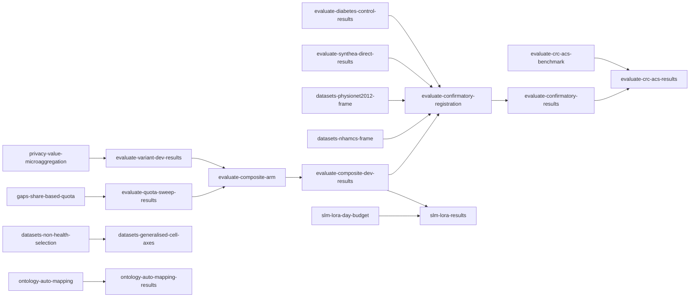

# Direct method: work-unit index

**What this set is.** The units that study `bko-direct` as the candidate of the direct-method study,
each one pull request. The plan is [`docs/RESEARCH.md`](../docs/RESEARCH.md); a unit that changes a
criterion, a definition or a decision an ADR records edits that document in its own PR. Each
unit's `milestone` is `direct-method-research`, the
[ROADMAP milestone](../docs/ROADMAP.md#direct-method-research) this set serves.

## Graph and status

### Controls

| Unit | Status | Depends on | Milestone |
|---|---|---|---|
| [`evaluate-diabetes-control-results`](evaluate-diabetes-control-results.md) | ready | -- | direct-method-research |
| [`evaluate-synthea-direct-results`](evaluate-synthea-direct-results.md) | ready | -- | direct-method-research |

### Method and measurement

| Unit | Status | Depends on | Milestone |
|---|---|---|---|
| [`privacy-value-microaggregation`](privacy-value-microaggregation.md) | ready | -- | direct-method-research |
| [`evaluate-variant-dev-results`](evaluate-variant-dev-results.md) | blocked | privacy-value-microaggregation | direct-method-research |
| [`gaps-share-based-quota`](gaps-share-based-quota.md) | ready | -- | direct-method-research |
| [`evaluate-quota-sweep-results`](evaluate-quota-sweep-results.md) | blocked | gaps-share-based-quota | direct-method-research |

### Datasets

| Unit | Status | Depends on | Milestone |
|---|---|---|---|
| [`datasets-physionet2012-frame`](datasets-physionet2012-frame.md) | ready | -- | direct-method-research |
| [`datasets-nhamcs-frame`](datasets-nhamcs-frame.md) | ready | -- | direct-method-research |
| [`datasets-non-health-selection`](datasets-non-health-selection.md) | ready | -- | direct-method-research |
| [`datasets-generalised-cell-axes`](datasets-generalised-cell-axes.md) | blocked | datasets-non-health-selection | direct-method-research |

### Published comparisons

| Unit | Status | Depends on | Milestone |
|---|---|---|---|
| [`evaluate-covariate-bias-results`](evaluate-covariate-bias-results.md) | ready | -- | direct-method-research |
| [`evaluate-tableshift-results`](evaluate-tableshift-results.md) | ready | -- | direct-method-research |
| [`evaluate-crc-acs-benchmark`](evaluate-crc-acs-benchmark.md) | ready | -- | direct-method-research |
| [`evaluate-crc-acs-results`](evaluate-crc-acs-results.md) | blocked | evaluate-crc-acs-benchmark, evaluate-confirmatory-results | direct-method-research |
| [`evaluate-synthetic-share-results`](evaluate-synthetic-share-results.md) | ready | -- | direct-method-research |

### Composite and confirmation

| Unit | Status | Depends on | Milestone |
|---|---|---|---|
| [`evaluate-composite-arm`](evaluate-composite-arm.md) | blocked | evaluate-variant-dev-results, evaluate-quota-sweep-results | direct-method-research |
| [`evaluate-composite-dev-results`](evaluate-composite-dev-results.md) | blocked | evaluate-composite-arm | direct-method-research |
| [`evaluate-confirmatory-registration`](evaluate-confirmatory-registration.md) | blocked | evaluate-diabetes-control-results, evaluate-synthea-direct-results, datasets-physionet2012-frame, datasets-nhamcs-frame, evaluate-composite-dev-results | direct-method-research |
| [`evaluate-confirmatory-results`](evaluate-confirmatory-results.md) | blocked | evaluate-confirmatory-registration | direct-method-research |

### Follow-ups

| Unit | Status | Depends on | Milestone |
|---|---|---|---|
| [`ontology-auto-mapping`](ontology-auto-mapping.md) | ready | -- | direct-method-research |
| [`ontology-auto-mapping-results`](ontology-auto-mapping-results.md) | blocked | ontology-auto-mapping | direct-method-research |
| [`slm-lora-day-budget`](slm-lora-day-budget.md) | ready | -- | direct-method-research |
| [`slm-lora-results`](slm-lora-results.md) | blocked | evaluate-composite-dev-results, slm-lora-day-budget | direct-method-research |

## What every unit relies on

- Everything the experiments set relies on
  ([`experiments-index.md`](experiments-index.md#what-every-unit-relies-on)).
- **No unit edits an existing `RUNS` entry, an existing dataset's field rows or `bko-direct`'s
  draw.** Old run folders are re-read under identity checks, and the draw is pinned by digests,
  so a sampler change is a new arm name and a mapping change is a new dataset name.
- **A code unit lands its runs' names and Configuration; a results unit runs them.** A code unit
  adds the arm or reading, its named `RUNS` entries and the
  [`docs/EVIDENCE.md`](../docs/EVIDENCE.md) entry's Configuration with status `not yet run`. A
  results unit runs it and records Runs, Result and Read against. A free reading over stores that
  already exist lands with its code unit, recorded as a Runs row in the code unit's PR; a
  reading that runs for hours is recorded by a results unit instead.
- **Which data is development and which is confirmatory is the plan's to say**
  ([`docs/RESEARCH.md`](../docs/RESEARCH.md)).

## Where results go

[`docs/EVIDENCE.md`](../docs/EVIDENCE.md): a new entry per question.

## Spend

As the experiments set's ([`experiments-index.md`](experiments-index.md#spend)).

## Conventions

As the experiments set's ([`experiments-index.md`](experiments-index.md#conventions)).
