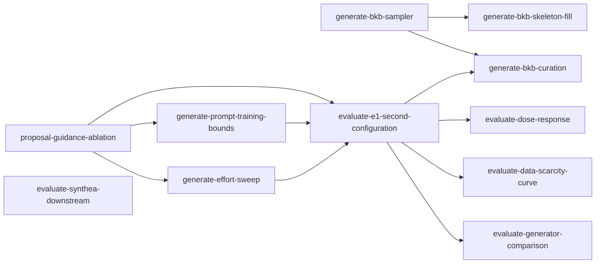

# Experiments: work-unit index

**What this set is.** The experiments that follow the first full evaluation
([`docs/EVIDENCE.md`](../docs/EVIDENCE.md#e1-uci-heart-disease-augmentation), E1): changes to
how records are generated, to how gaps are detected, and to the power of the evaluation, each one
pull request. The plan is
[`docs/RESEARCH.md`](../docs/RESEARCH.md); a unit that changes a criterion, a definition or a
decision an ADR records edits that document in its own PR. The guidance-level ablation stays in
[`proposal-index.md`](proposal-index.md). Owners follow the
workstreams of [`docs/ROADMAP.md`](../docs/ROADMAP.md#workload), and each unit's `milestone` names
the ROADMAP heading it serves.

## Graph and status

### Generation

| Unit | Status | Depends on | Owner | Milestone |
|---|---|---|---|---|
| [`generate-prompt-training-bounds`](generate-prompt-training-bounds.md) | blocked | proposal-guidance-ablation | Shirley | final-report |
| [`generate-effort-sweep`](generate-effort-sweep.md) | blocked | proposal-guidance-ablation | Shirley | final-report |
| [`generate-bkb-sampler`](generate-bkb-sampler.md) | ready | -- | Partiban | final-report |
| [`generate-bkb-skeleton-fill`](generate-bkb-skeleton-fill.md) | blocked | generate-bkb-sampler | Shirley | final-report |
| [`generate-bkb-curation`](generate-bkb-curation.md) | blocked | generate-bkb-sampler, evaluate-e1-second-configuration | Shirley | final-report |

### Evaluation power

| Unit | Status | Depends on | Owner | Milestone |
|---|---|---|---|---|
| [`evaluate-e1-second-configuration`](evaluate-e1-second-configuration.md) | blocked | proposal-guidance-ablation, generate-prompt-training-bounds, generate-effort-sweep | Joe | final-report |
| [`evaluate-dose-response`](evaluate-dose-response.md) | blocked | evaluate-e1-second-configuration | Joe | final-report |
| [`evaluate-data-scarcity-curve`](evaluate-data-scarcity-curve.md) | blocked | evaluate-e1-second-configuration | Joe | final-report |
| [`evaluate-generator-comparison`](evaluate-generator-comparison.md) | blocked | evaluate-e1-second-configuration | Shirley | final-report |
| [`evaluate-synthea-downstream`](evaluate-synthea-downstream.md) | ready | -- | Joe | final-report |

The diagram draws this set's edges and the edges out of `proposal-guidance-ablation`, whose own
set is [`proposal-index.md`](proposal-index.md).

## What every unit relies on

- **Replay pairs calls by order and refuses a differing request** (ADR
  [`research/call-log-replay`](../docs/adr/research/call-log-replay.md)), so a unit that changes
  what a call sends makes the judged run's log unreplayable until the next judged run. The graph
  orders every unit that reads the judged log by replay before every unit that changes a call, and
  a unit's acceptance that names a replay holds at a commit where the judged log replays.
- **No flag changes a value of `E1`** (`bko.evaluate.experiment`; ADR
  [`research/e1-evaluation-protocol`](../docs/adr/research/e1-evaluation-protocol.md) rules out
  flags for the readings or the holdout count), so a variant is a configuration fixed in code and
  selected by name, a value of `bko.evaluate.experiment.RUNS`.
- **A paid run starts with `launch` and stops on the rules of `bko.evaluate.watch`**, the paid-run
  protocol of [`docs/DEVELOPMENT.md`](../docs/DEVELOPMENT.md#evaluation), which every paid unit
  cites.

## Where results go

[`docs/EVIDENCE.md`](../docs/EVIDENCE.md): a Runs row of E1 or E2 when a unit reruns one under a
new configuration, and a new entry when it answers a new question. A changed detection rule is a
new entry, not an E2 row (ADR
[`research/frequency-aware-gap-score`](../docs/adr/research/frequency-aware-gap-score.md)).

## Spend

- A paid unit estimates its spend before it runs, in its Runs row, from the judged run's Runs row
  in [`docs/EVIDENCE.md`](../docs/EVIDENCE.md#e1-uci-heart-disease-augmentation): its tokens per
  record asked, the rows the unit's request asks, and the model's rates at
  `bko.generate.spend.PRICES`. The estimate and the ceiling are recomputed when `SETTINGS.model`
  or its `PRICES` row changes (ADR `research/e1-evaluation-protocol`).
- The ceiling reads the whole run's `usd`, replayed and resumed calls included
  ([`docs/DEVELOPMENT.md`](../docs/DEVELOPMENT.md#evaluation)), so an estimate for a resumed run
  adds the resumed log's spend, and a run stopped at the ceiling cannot resume.
- A named run carries its own ceiling in its `Experiment`. A unit whose estimate passes that
  ceiling stops and reports before running; raising a ceiling is a commit, and that commit is the
  sign-off.
- A paid run's stderr, call log and scores go to its run folder
  ([`docs/DEVELOPMENT.md`](../docs/DEVELOPMENT.md#runs)); the Runs row records their sha256s.

## Conventions

- A unit is one PR. A landed unit's file is deleted after rehoming anything it deferred, and its
  row leaves the board; each unit it blocked drops it from `depends_on`, and becomes `ready`
  when none remain.
- A unit names a future ADR in its `adrs:` frontmatter only; prose says "a new ADR under
  `docs/adr/<topic>/`". A unit that edits an existing ADR names it in prose and keeps `adrs: --`.
- `paid: true` marks a unit that calls a paid API. Its tests are marked `live`, and each run's spend
  is recorded in the Runs field of its `docs/EVIDENCE.md` entry.
- `parallel_safe: true` means the unit can be developed beside the others; `false` means it must
  land alone (for example, it rewrites a file every other unit reads).
- `tests/test_task_units.py` enforces the unit schema, the board and the diagram.
