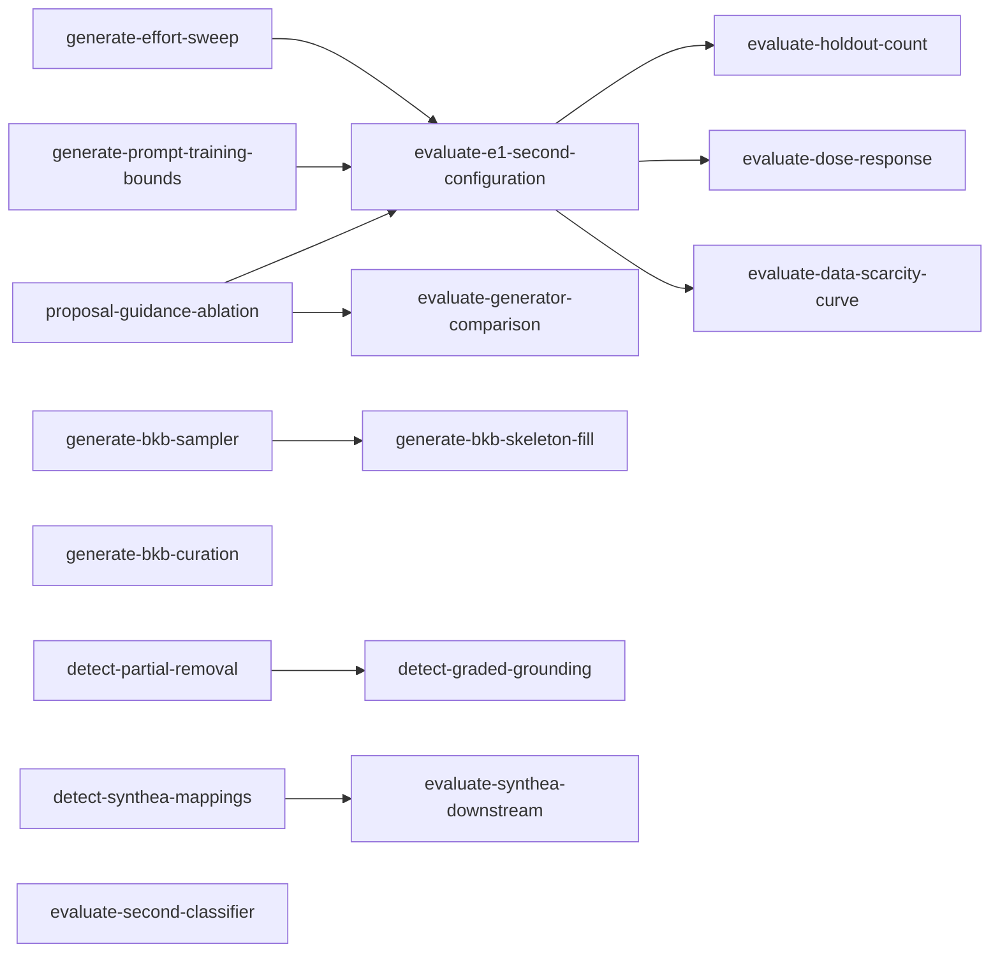

# Experiments: work-unit index

**What this set is.** The experiments that follow the first full evaluation
([`docs/EVIDENCE.md`](../docs/EVIDENCE.md#e1-uci-heart-disease-augmentation), E1): changes to how
records are generated, to how gaps are detected, and to the power of the evaluation, each one pull
request. The plan is [`docs/RESEARCH.md`](../docs/RESEARCH.md); a unit that changes a criterion or
a definition edits it and its ADR first. The guidance-level ablation that several units wait on
stays in [`proposal-index.md`](proposal-index.md). Owners follow the workstreams of
[`docs/ROADMAP.md`](../docs/ROADMAP.md#workload), and each unit's `milestone` names the ROADMAP
heading it serves.

## Graph and status

### Generation

| Unit | Status | Depends on | Owner | Milestone |
|---|---|---|---|---|
| [`generate-prompt-training-bounds`](generate-prompt-training-bounds.md) | ready | -- | Shirley | final-report |
| [`generate-effort-sweep`](generate-effort-sweep.md) | ready | -- | Shirley | final-report |
| [`generate-bkb-sampler`](generate-bkb-sampler.md) | ready | -- | Partiban | final-report |
| [`generate-bkb-curation`](generate-bkb-curation.md) | ready | -- | Shirley | final-report |
| [`generate-bkb-skeleton-fill`](generate-bkb-skeleton-fill.md) | blocked | generate-bkb-sampler | Shirley | final-report |

### Detection

| Unit | Status | Depends on | Owner | Milestone |
|---|---|---|---|---|
| [`detect-partial-removal`](detect-partial-removal.md) | ready | -- | Partiban | final-report |
| [`detect-graded-grounding`](detect-graded-grounding.md) | blocked | detect-partial-removal | Partiban | final-report |
| [`detect-synthea-mappings`](detect-synthea-mappings.md) | ready | -- | Partiban | final-report |

### Evaluation power

| Unit | Status | Depends on | Owner | Milestone |
|---|---|---|---|---|
| [`evaluate-second-classifier`](evaluate-second-classifier.md) | ready | -- | Joe | final-report |
| [`evaluate-e1-second-configuration`](evaluate-e1-second-configuration.md) | blocked | proposal-guidance-ablation, generate-prompt-training-bounds, generate-effort-sweep | Joe | final-report |
| [`evaluate-holdout-count`](evaluate-holdout-count.md) | blocked | evaluate-e1-second-configuration | Joe | final-report |
| [`evaluate-dose-response`](evaluate-dose-response.md) | blocked | evaluate-e1-second-configuration | Joe | final-report |
| [`evaluate-data-scarcity-curve`](evaluate-data-scarcity-curve.md) | blocked | evaluate-e1-second-configuration | Joe | final-report |
| [`evaluate-generator-comparison`](evaluate-generator-comparison.md) | blocked | proposal-guidance-ablation | Shirley | final-report |
| [`evaluate-synthea-downstream`](evaluate-synthea-downstream.md) | blocked | detect-synthea-mappings | Joe | final-report |

## Where results go

[`docs/EVIDENCE.md`](../docs/EVIDENCE.md): a Runs row of E1 or E2 when a unit reruns one under a
new configuration, and a new entry when it answers a new question. This file states no figure.

## Spend

A paid unit estimates its spend from `e1-3`'s Runs row in
[`docs/EVIDENCE.md`](../docs/EVIDENCE.md#e1-uci-heart-disease-augmentation) before it runs: that
run filled three BKO arms, each with a gap fill and a replica fill, on 100 holdouts, so one arm's
full run is a third of its spend and of its live minutes per holdout. A unit whose estimate passes
`E1.spend_ceiling` stops and reports before running.

## Conventions

Those of [`proposal-index.md`](proposal-index.md#conventions): one PR per unit, a landed unit's
file deleted, `paid` marking a unit that calls a paid API, `parallel_safe: false` marking one that
must land alone, and `tests/test_task_units.py` enforcing the schema, the boards and the diagram.
A unit that pays a [`CLEANUP.md`](CLEANUP.md) entry cites its key and deletes the entry in the
commit that pays it.
