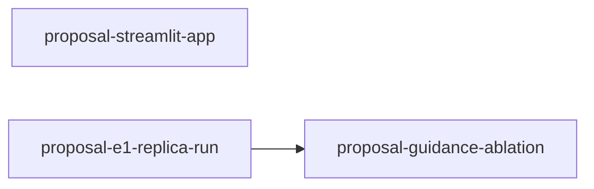

# Proposal: work-unit index

**What this set is.** The work the 2-pager proposes, from the BKB layer to the final evaluation,
and a guidance-level ablation of generation, split into units of one pull request each. The plan
is [`docs/RESEARCH.md`](../docs/RESEARCH.md), the dates are in
[`docs/ROADMAP.md`](../docs/ROADMAP.md) (this file copies none), and owners follow 2-pager
section 6. Each unit's `milestone` names the ROADMAP heading it serves.

## Graph and status

| Unit | Status | Depends on | Owner | Milestone |
|---|---|---|---|---|
| [`proposal-streamlit-app`](proposal-streamlit-app.md) | ready | -- | Krish | working-prototype |
| [`proposal-guidance-ablation`](proposal-guidance-ablation.md) | blocked | proposal-e1-replica-run | Shirley | final-report |
| [`proposal-e1-replica-run`](proposal-e1-replica-run.md) | ready | -- | Joe | final-report |

## Where results go

[`docs/EVIDENCE.md`](../docs/EVIDENCE.md). This file states no figure.

## Conventions

- A unit is one PR. A landed unit's file is deleted after rehoming anything it deferred, and its
  row leaves the board; units it blocked become `ready`.
- A unit names a future ADR in its `adrs:` frontmatter only; prose says "a new ADR under
  `docs/adr/<topic>/`".
- `paid: true` marks a unit that calls a paid API. Its tests are marked `live`, and each run's spend
  is recorded in the Runs field of its `docs/EVIDENCE.md` entry.
- `parallel_safe: true` means the unit can be developed beside the others; `false` means it must
  land alone (for example, it rewrites a file every other unit reads).
- `tests/test_task_units.py` enforces the unit schema, the board and the diagram.
